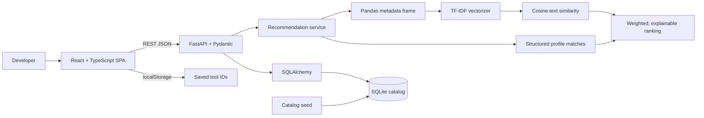

# System architecture

## Data flow

At startup, the FastAPI lifespan creates the `tools` table and seeds the catalog if it is empty. API routes serialize SQLAlchemy records with Pydantic response models. `/api/recommend` loads current tools, builds a text corpus and a user query, calculates similarity and structured matches, then returns ranked records with explanations. The browser stores only favorite IDs in local storage; the catalog remains the source of tool details.

## API boundaries

The Vite development server is on port 5173 and FastAPI on port 8000. CORS permits the two loopback frontend origins. `src/api.ts` centralizes fetch/error handling. Production hosting should configure a same-origin reverse proxy or an explicit `VITE_API_URL` and a restricted CORS allowlist.
