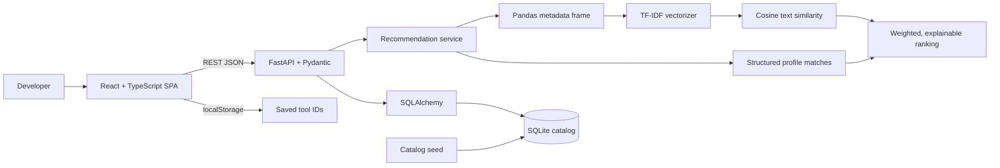

# System architecture

## Data flow

At startup, the FastAPI lifespan creates the `tools` table and adds any missing names from the 172-entry seed catalog. Existing rows are preserved. API routes serialize SQLAlchemy records with Pydantic response models. `/api/recommend` loads current tools, builds a text corpus and a user query, calculates similarity and structured matches, then returns ranked records with explanations. The browser stores only favorite IDs in local storage; the catalog remains the source of tool details.

## API boundaries

The Vite development server is on port 5173 and FastAPI on port 8000. CORS permits the two loopback frontend origins plus the configured `FRONTEND_ORIGINS` allowlist. `src/api.ts` centralizes fetch/error handling and uses `VITE_API_BASE_URL` for the production API origin.
